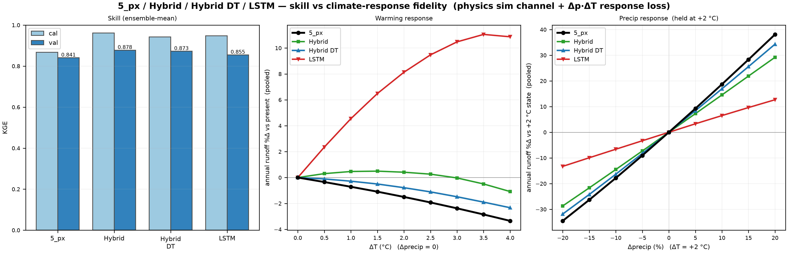

# Learned parameters

Differentiable parameter learning ("dPL", [Tsai et al., 2021](references.md#tsai2021);
[Feng et al., 2022](references.md#feng2022)) replaces the genetic-algorithm search with a small
neural network trained by gradient descent. The network reads the attributes of a modeling unit
and returns its SAC-SMA parameters; the model chain is unchanged. Code: `sacsma.dpl`.

```math
\phi_i = g_\theta(A_i), \qquad \hat{Q} = \mathcal{M}(\phi, F), \qquad
\theta^* = \arg\min_\theta \; \mathcal{L}\big(\hat{Q}, Q^{obs}\big)
```

$A_i$ are the attributes of unit $i$, $\phi_i$ its parameters, $\mathcal{M}$ the model driven
by forcing $F$. No watershed identity enters the network, so one trained network gives
parameters for any place with the same attributes.

## How it is built

**The network.** A per-unit multilayer perceptron (hidden width 64, embedding 32). It emits 28
of the 31 parameters inside the ranges the GA searched ([parameter table](equations.md#6-parameter-table));
two ranges are widened (`rexp` up to 15, `lzsk` down to 0.001). `lzsk`, `lzpk`, `MFMAX` and
`MFMIN` are mapped in log space, so the network can reach the low end of their ranges. With the
learned rain/snow threshold a separate output gives `PXTEMP`, and with the deep store a separate
head gives its share and residence time (below). The untrained network returns the
area-weighted median of the `15cdec_grid` GA parameters, so training starts from a plausible field.

**Inputs.** Two sets are in use (`sacsma dpl train <inputs>`):

| Inputs | What the network reads |
|---|---|
| `physical` | elevation, position, flow length, POLARIS soil properties ([Chaney et al., 2019](references.md#chaney2019)), LANDFIRE vegetation, 3DEP terrain, MODIS leaf-area statistics |
| `aef_u` | AlphaEarth satellite embeddings: 16 principal components of the unit embedding direction and its length |

**The physics.** PyTorch, all units in one batch, the reference model's equations
([The model](model.md)) with the percolation sub-steps fixed at ten a day: the reference takes a
number that varies with the state, which cannot be batched. Options on top of the reference
chain:
Priestley–Taylor PET ([Priestley & Taylor, 1972](references.md#priestleytaylor1972)) with
radiation from the daily temperature range
([Bristow & Campbell, 1984](references.md#bristowcampbell1984); [Allen et al., 1998](references.md#allen1998)),
a soil-moisture-limited ET on observed vegetation in the manner of the Noah model
([Ek et al., 2003](references.md#ek2003); [Koren et al., 2010](references.md#koren2010)) with
the SAC-SMA exchange terms kept around it, a learned rain/snow threshold, and a deep store.

**The deep store** (`--deep-store cascade`, from rung `6_deep`). A second slow reservoir behind
the supplemental lower-zone store. In each percolation sub-step it takes a share $g$ of the
supplemental drainage, after that water has left the lower zone, and drains into the baseflow:

```math
q_s = lzfsc\;dlzs, \qquad
bf_s = (1 - g)\,q_s + S\,d_{deep}, \qquad
S \leftarrow S\,(1 - d_{deep}) + g\,q_s, \qquad
d_{deep} = 1 - \Big(1 - \frac{1}{365.25\,\tau}\Big)^{1/n_{inc}}
```

$S$ is the store's content at the start of the sub-step (empty at the cold start): the store
drains, then takes its share. $q_s$ is the supplemental drainage of the sub-step ([Model
equations](equations.md#3-sac-sma)) and $bf_s$ the supplemental baseflow that reaches the
channel. The share $g$ (0 to 0.5) and the residence time $\tau$ (2 to 10 years) come from a
separate head of the network, which starts every cell at $g = 0.01$ and $\tau$ at about 4.5
years and has its own learning rate (`--deep-lr-mult`): 10 times the network's at the start,
decaying with it to the same final rate. The store is outside the lower-zone deficit, the
percolation demand and the resupply of the tension water, and it has no ET, so the soil states
are those of the same field without it; it only re-times part of the baseflow.

Why a separate store rather than a slower SAC-SMA lower zone:

- **The slow store is already at its limit.** In the trained fields the supplemental store
  drains at 0.0043 a day at the median (about 8 months), and the network pressed `lzsk` against
  every floor it was given: 0.01 in the GA box, then 0.003, then 0.001, with a quarter of
  dPL-CalSim's cells below 0.002.
- **A larger or slower lower zone changes how storms split.** The lower zone's free stores set
  the percolation demand, $(lzfpm\,dlzp + lzfsm\,dlzs)(1 + zperc\cdot defr^{rexp})$. A store that
  stays in deficit for years keeps that demand high, the upper zone holds less free water on
  storm days, and the interflow that makes the flood peaks goes. A retrain that grew Oroville's
  free lower-zone capacity from 3.3 to 6.5 m lost its interflow and 10 points of its Sierra
  flood peaks ([Runs](runs.md#tried-and-not-adopted)).
- **The literature asks for this structure.** Common conceptual models empty on a seasonal cycle
  and cannot carry a deficit from one dry year to the next
  ([Fowler et al., 2020](references.md#fowler2020)), and they lose skill in multi-year droughts
  ([Trotter et al., 2023](references.md#trotter2023)). In the Feather River headwaters a model
  lost skill in the same way, and the authors call for carry-over storage in deeper regolith
  ([Avanzi et al., 2020](references.md#avanzi2020)). Of 46 conceptual models tested for
  multi-annual storage, 5 of the 9 with a long-term store kept apart from direct runoff
  generation and with a loss from it reproduced it, against 1 of the other 37
  ([Zhang et al., 2026](references.md#zhang2026)); an added slow reservoir improved low flows
  elsewhere ([Cenobio-Cruz et al., 2023](references.md#cenobiocruz2023)).
  Mountain baseflow is years old: 3 to 12 years in a snow-dominated headwater basin
  ([Carroll et al., 2020](references.md#carroll2020)), with water held in weathered rock 10 to
  20 m deep in the southern Sierra ([Klos et al., 2018](references.md#klos2018)).
- **Fed from the supplemental drainage, in series.** The store lengthens the slowest recession
  rather than splitting percolation in parallel. In a test on dPL-CalSim's field, a store fed
  from the primary drainage instead brought the five largest annual peaks of four Sierra
  watersheds to 72–75 % of observed, against 76.5 % fed from the supplemental drainage.

Two limits. The store has no loss: all of its water returns to the channel, while the models
that worked in [Zhang et al. (2026)](references.md#zhang2026) lose some. And $g$ and $\tau$ are
identified from streamflow alone, which gave a bedrock store implausible parameters in
[La Follette et al. (2022)](references.md#lafollette2022). In dPL-CalSim's field $g$ is 0.28 at
the median (20 % of the cells at 0.45 or more) and $\tau$ 8.4 years; in `6_deep`, trained on
the 15 watersheds alone, $g$ is 0.42 (43 % at 0.45 or more) and $\tau$ spreads over the whole
range (2.1 to 9.6 years from the 10th to the 90th percentile).

**Training.** One recipe for every run ([the ladder](runs.md#the-ladder)). The loss is a squared
error normalized by each watershed's observed variance, plus a log-flow term and a term that
matches the variance over the record, each chunk weighted by its days. Optimization is AdamW
over water-year chunks, with the model state carried from chunk to chunk and the gradient carried
through two water years: with one, the gradient on the slow lower-zone drainage and on `Kpet` at
Shasta has the wrong sign. The network kept is the one with the best training-period KGE, scored
on the CPU after every epoch.

**Scoring.** A run is scored as it was trained: its field runs on the engine with the numerics
and the basin weights of its training, over the whole record from the cold start
(`sacsma dpl evaluate <checkpoint>`). Test years are never read in training or selection.

## Results on the 15 CDEC watersheds

Each rung of the ladder changes one thing from the one before it: the network in place of the
GA (`1_hru`), grid cells and CalSim3 outlines in place of HRUs (`2_grid`), Priestley–Taylor PET
(`3_pt`), the Noah-type ET (`4_noah`), the learned rain/snow threshold (`5_px`), the deep store
(`6_deep`) and AlphaEarth inputs (`7_aef`). Rungs 1 to 7 train on WY1989–2003. Their mean daily
KGE over the 15 watersheds on WY2004–18 goes 0.768 (GA), 0.838, 0.826, 0.843, 0.844, 0.841,
0.841, 0.839; the table, with the held-out decade WY1976–85 and the regional records, is in
[Runs](runs.md#the-ladder).

What these runs show:

- **The network generalizes better than the GA with the same physics.** +0.09 on WY1976–85,
  where 10 of the 13 outlets gain (median +0.03). The +0.07 on WY2004–18 is SCC's (−0.18 to
  0.62): 7 of the 15 outlets gain and the median change is 0.00.
- **The grid costs little.** About 0.01 to 0.02 at the outlets, and it is the form that covers
  the CalSim3 catchments.
- **The physics options are even at the 15 outlets.** Priestley–Taylor PET gains about 0.02;
  the Noah-type ET and the learned threshold change the mean by less than 0.01. They are kept
  because PET then responds to radiation, ET to modeled soil moisture, and the snow line to a
  learned threshold.
- **The deep store leaves the 15 watersheds as they were.** The means move by less than 0.005
  except on the USGS gauges on WY1976–85 (−0.013, the median −0.002).
- **AlphaEarth inputs are even at the outlets and transfer a little better** to the records the
  run did not train on: on WY1976–85 the subbasins gain +0.04 (6 of 9 up) and the arcs +0.03 (40
  of 64); the USGS gauges +0.006. Against the physical rungs read on point-sampled statics
  outside the 15-CDEC grid, before those inputs were corrected, the gains looked larger
  ([Runs](runs.md#the-ladder)).
- **An LSTM on the physics adds skill and loses the response to warming** unless it is trained
  to keep it (`hybrid_dt`), which keeps most of the skill and about 60 % of the change in annual
  runoff. See below.
- **Weaknesses that stayed.** SCC has the lowest WY2004–18 score in every rung (0.45 to 0.62)
  and in `hybrid` and `hybrid_dt`.

## The LSTM hybrids and their response to warming

`hybrid` feeds precipitation, Tmin, Tmax and `5_px`'s simulated flow to an LSTM
([Hochreiter & Schmidhuber, 1997](references.md#hochreiter1997);
[Kratzert et al., 2019](references.md#kratzert2019)), with 27 static attributes of each
watershed (`5_px`'s physical inputs and four climate indices), and scores an ensemble of three
seeds. `hybrid_dt` fine-tunes each `hybrid` seed for 15 epochs with a loss term that pulls the
network's change in flow under 14 combinations of precipitation change (−20 to +20 %) and
warming (0, +2, +4 °C) toward the change `5_px` gives. `lstm` drops the simulated flow from the
inputs. Each network (hidden size 64) trains for 60 epochs with Adam at a learning rate of 1e-3,
without dropout, input noise, weight decay or a log-flow term, and keeps the epoch with the best
training-period KGE. With 15 watersheds the statics can serve as a label for each one; in
single-seed tests a one-hot label in their place did about as well.

| | WY1989–2003 (training) | WY2004–18 | WY1976–85 (monthly, 13 outlets) |
|---|---|---|---|
| `5_px` | 0.868 | 0.841 | 0.859 |
| `hybrid` | 0.961 | 0.878 | 0.860 |
| `hybrid_dt` | 0.942 | 0.873 | 0.880 |
| `lstm` | 0.948 | 0.855 | 0.782 |

`hybrid`'s gain on WY2004–18 does not reach the older held-out decade, where it is level with
`5_px`. `hybrid_dt`'s response term holds it there: it keeps most of the skill in both windows.

Change at +3 °C with precipitation unchanged, over the 15 watersheds
(`artifacts/results/dpl/studies/hybrids/hybrids_metrics.csv`):

| | Annual runoff, mean | Same sign as `5_px` | Correlation with `5_px` across watersheds | April–July volume, mean |
|---|---|---|---|---|
| `5_px` | −2.4 % | | | −33 % |
| `hybrid` | 0.0 % | 9 of 15 | 0.45 | −23 % |
| `hybrid_dt` | −1.5 % | 13 of 15 | 0.83 | −29 % |
| `lstm` | +10.5 % | 2 of 15 | 0.28 | −5 % |

`hybrid` keeps most of the physics' shift away from spring, but its annual runoff hardly changes:
from −5.8 % to +5.1 % across watersheds, and slightly up below +2.5 °C. `hybrid_dt` keeps about
60 % of the annual change and about 90 % of the spring change. `lstm` gains runoff as it warms.
With precipitation changed by ±10 or ±20 % at +2 °C, `hybrid_dt` gives about 90 % of `5_px`'s
change in annual runoff, `hybrid` about 77 % and `lstm` about 36 %.



## From 15 watersheds to the CalSim3 arcs

The rungs above train on 15 daily records. dPL-CalSim (`8_calsim`) trains one network on several
kinds of record at once (daily gauges, monthly unimpaired flows, CalSim3 arc inflows) and its
flow becomes monthly inflows on the CalSim3 rim arcs: [CalSim3 rim inflows](calsim3_rim_inflows.md).

## Where things are

| | |
|---|---|
| Runs | `artifacts/models/dpl/15cdec/<run>/` (checkpoints, parameter tables), `artifacts/results/dpl/15cdec/<run>/` (scores); dPL-CalSim under `multifamily/8_calsim/` |
| Every run's scores, and what was tried and not adopted | [Runs](runs.md) |
| Studies and their figures | [`artifacts/results/dpl/studies/`](../artifacts/results/dpl/studies/), one folder per `sacsma dpl study` |
| The learned numerics against the reference model | [`artifacts/results/dpl/fidelity/`](../artifacts/results/dpl/fidelity/) |

```bash
sacsma dpl fidelity                          # learned numerics against the reference model
sacsma dpl train physical --domain 15cdec --et sac --sac-pet hamon \
    --cpu-select --diagnostics --patience 20 \
    --obs-mask data/targets/cdec/fnf_daily_mask.csv \
    --log-space lzsk,lzpk,MFMAX,MFMIN --param-bounds lzsk=0.001:0.5 --logit-penalty 0.01   # 1_hru
sacsma dpl evaluate <run>/checkpoints/best.pt
sacsma dpl hybrid --physics 5_px --seed 0    # hybrid; lstm: without --physics
sacsma dpl study climatology                 # and: hybrids, forcing
```

Every rung's command is in [Reproduce](reproduce.md).
